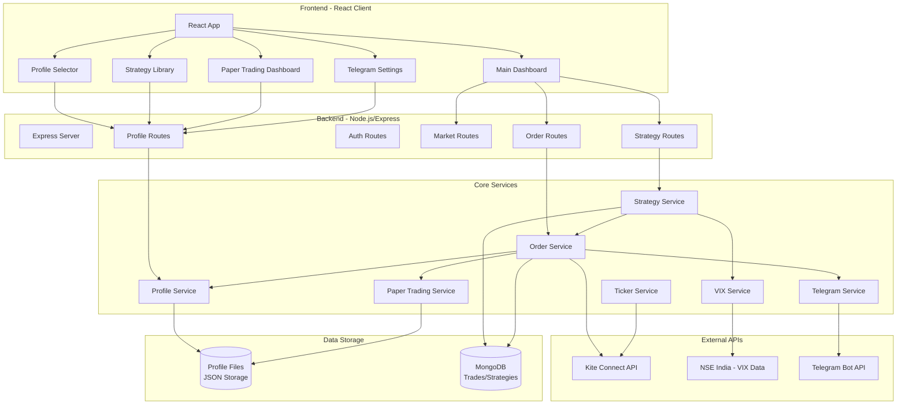
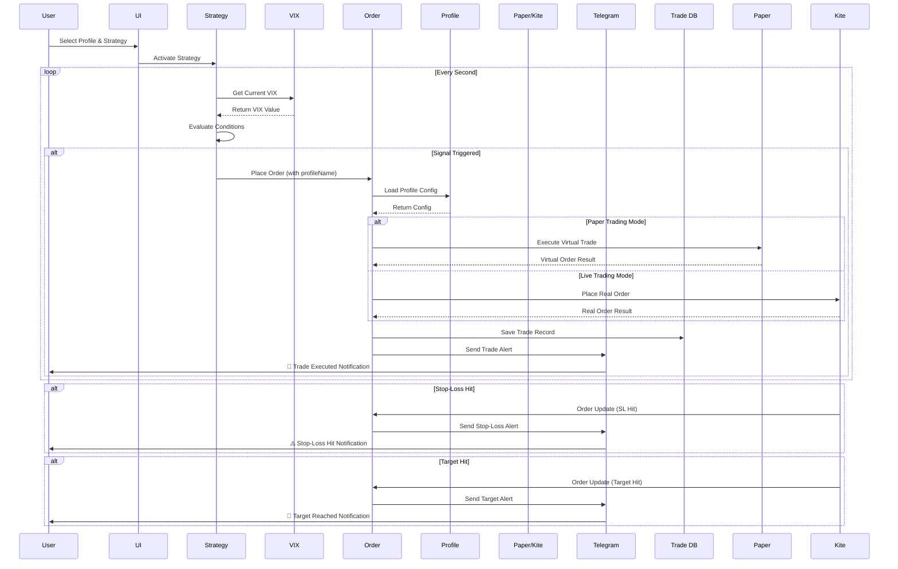

# System Architecture & Integration Guide

## Overview

This document explains how all the new personal-use features integrate with the existing algo trading platform to create a complete group-friendly trading system.

## 🏗️ System Architecture



## 🔄 Trading Flow with Integrations



## 📂 File Structure

```
AlgoTrading/
├── backend/
│   ├── config/
│   │   ├── trading.config.js          # Centralized trading parameters
│   │   └── default-strategies.js      # 10 pre-built strategies
│   ├── services/
│   │   ├── profile.service.js         # Profile management
│   │   ├── paper-trading.service.js   # Simulated trading
│   │   ├── telegram.service.js        # Notifications
│   │   ├── vix.service.js            # Volatility monitoring
│   │   ├── order.service.js          # Order execution (MODIFIED)
│   │   └── strategy.service.js       # Strategy evaluation (MODIFIED)
│   ├── controllers/
│   │   └── profile.controller.js      # Profile API endpoints
│   ├── routes/
│   │   └── profile.routes.js          # Profile routes
│   ├── models/
│   │   └── Trade.model.js            # Trade schema (MODIFIED)
│   └── profiles/                      # User profile storage
│       ├── john/
│       │   ├── config.json
│       │   ├── strategies.json
│       │   └── trades.json
│       └── alice/
│           └── ...
├── client/
│   └── src/
│       └── components/
│           ├── ProfileSelector/       # NEW: Profile switcher
│           ├── StrategyLibrary/       # NEW: Browse strategies
│           ├── PaperTradingDashboard/ # NEW: Virtual portfolio
│           ├── TelegramSettings/      # NEW: Notification config
│           └── Settings/              # NEW: Settings page
└── create-profile.js                  # CLI tool for profile creation
```

## 🔌 Integration Points

### 1. Profile Integration

**How it works:**
- Each user has a profile stored as JSON files in `profiles/{username}/`
- Profile contains: trading preferences, risk settings, strategies, capital
- Profile is selected via UI and passed to all trading operations

**Integration in code:**
```javascript
// order.service.js
async placeOrder(orderParams, strategyId, signalData, profileName) {
  // Load profile config
  const profileConfig = await profileService.getProfileConfig(profileName);
  
  // Check if paper trading
  const isPaperTrading = profileConfig?.trading?.paperTrading;
  
  // Route to appropriate service
  if (isPaperTrading) {
    await paperTradingService.placeOrder(...);
  } else {
    await this.kite.placeOrder(...);
  }
}
```

### 2. Paper Trading Integration

**How it works:**
- Virtual trading with simulated capital (default ₹1,00,000)
- Realistic execution with slippage and brokerage
- All trades stored in profile's `trades.json`
- No connection to Kite API

**Integration in code:**
```javascript
// order.service.js - Routes to paper trading when flag is set
if (isPaperTrading) {
  response = await paperTradingService.placeOrder({
    tradingSymbol: orderParams.tradingsymbol,
    transactionType: orderParams.transaction_type,
    quantity: orderParams.quantity,
    orderType: orderParams.order_type,
    price: orderParams.price,
    product: orderParams.product
  });
}
```

### 3. VIX Integration

**How it works:**
- Fetches India VIX from NSE every 5 minutes
- Adjusts stop-loss, take-profit, and quantity based on volatility
- High VIX = tighter stops, smaller positions (risk reduction)
- Low VIX = wider stops, larger positions (profit maximization)

**Integration in code:**
```javascript
// strategy.service.js - Applies VIX adjustments before placing orders
const currentVIX = vixService.getCurrentVIX();
const adjustedParams = applyVIXAdjustment({
  stopLoss: tradeConfig.stopLoss,
  takeProfit: tradeConfig.takeProfit,
  quantity: tradeConfig.quantity
}, currentVIX);

// Use adjusted values for order
await orderService.placeOrder({
  ...orderParams,
  quantity: adjustedParams.quantity,
  stopLoss: adjustedParams.stopLoss,
  takeProfit: adjustedParams.takeProfit
}, ...);
```

**VIX Adjustment Logic:**
```javascript
// VIX < 15 (Low Volatility):    -20% stop, +30% target, +20% quantity
// VIX 15-20 (Normal):            No adjustment
// VIX 20-30 (High):             +20% stop, -20% target, -30% quantity
// VIX > 30 (Extreme):           +50% stop, -30% target, -50% quantity
```

### 4. Telegram Integration

**How it works:**
- Users create Telegram bot via @BotFather
- Configure bot token and chat ID in profile
- System sends real-time alerts for:
  - ✅ Trade executed
  - ⚠️ Stop-loss hit
  - 🎯 Target reached
  - 📊 Daily summary

**Integration in code:**
```javascript
// order.service.js - Sends notification after order execution
if (profileConfig?.trading?.notifications?.telegram?.enabled) {
  const telegram = profileConfig.trading.notifications.telegram;
  if (telegram.onTradeExecuted) {
    await telegramService.notifyTradeExecuted(telegram.chatId, {
      symbol: orderParams.tradingsymbol,
      type: orderParams.transaction_type,
      quantity: orderParams.quantity,
      price: response.average_price || orderParams.price
    });
  }
}

// order.service.js - Notifies on stop-loss/target hits
async updateOrderStatus(orderUpdate) {
  // ... existing code ...
  
  // Check if stop-loss hit
  if (trade.stopLoss && currentPrice <= (trade.entryPrice * (1 - trade.stopLoss/100))) {
    await telegramService.notifyStopLossHit(telegram.chatId, {...});
  }
  // Check if target hit
  else if (trade.takeProfit && currentPrice >= (trade.entryPrice * (1 + trade.takeProfit/100))) {
    await telegramService.notifyTargetReached(telegram.chatId, {...});
  }
}
```

### 5. Strategy Library Integration

**How it works:**
- 10 pre-built strategies with backtested results
- Each strategy has configuration: indicators, stop-loss, target, risk level
- Users browse library via UI and adopt strategies to their profile
- Adopted strategies are saved in `profiles/{username}/strategies.json`

**Default Strategies:**
1. **RSI Oversold Recovery** - Buy when RSI < 30 (Low Risk, 65% win rate)
2. **Golden Cross Momentum** - Buy on MA crossover (Medium Risk, 58% win rate)
3. **VWAP Breakout** - Buy on VWAP breach (Medium Risk, 62% win rate)
4. **Buyer-Seller Imbalance** - Buy on high buyer ratio (High Risk, 55% win rate)
5. **Volume Surge Detector** - Buy on volume spike (Medium Risk, 60% win rate)
6. **Mean Reversion** - Buy pullbacks (Low Risk, 63% win rate)
7. **Breakout Trader** - Buy new highs (High Risk, 52% win rate)
8. **Volatility Contraction** - Buy low volatility breakouts (Medium Risk, 61% win rate)
9. **RSI Momentum** - Buy RSI 50-70 range (Low Risk, 64% win rate)
10. **Multi-Timeframe Trend** - Buy aligned trends (Medium Risk, 67% win rate)

## 💻 UI Components

### ProfileSelector Component
- **Location:** `client/src/components/ProfileSelector/ProfileSelector.js`
- **Purpose:** Switch between user profiles
- **Features:**
  - Dropdown to select active profile
  - Displays profile stats (risk level, max loss, paper trading status)
  - Refresh profiles button
  - Shows Telegram alert status

### PaperTradingDashboard Component
- **Location:** `client/src/components/PaperTradingDashboard/PaperTradingDashboard.js`
- **Purpose:** View virtual portfolio and trades
- **Features:**
  - Total capital and available balance
  - Current portfolio value and P&L
  - Open positions and completed trades
  - Trade history table with P&L breakdown

### StrategyLibrary Component
- **Location:** `client/src/components/StrategyLibrary/StrategyLibrary.js`
- **Purpose:** Browse and adopt pre-built strategies
- **Features:**
  - Grid view of all 10 strategies
  - Strategy cards with backtested metrics
  - Risk level badges (Low/Medium/High)
  - Expand to view tips and best practices
  - One-click adoption to profile

### TelegramSettings Component
- **Location:** `client/src/components/TelegramSettings/TelegramSettings.js`
- **Purpose:** Configure Telegram notifications
- **Features:**
  - Enable/disable Telegram alerts
  - Configure bot token and chat ID
  - Test message feature
  - Notification preferences (trade executed, stop-loss, target, daily summary)
  - Help section with setup instructions

### Settings Page
- **Location:** `client/src/components/Settings/Settings.js`
- **Purpose:** Main settings hub
- **Features:**
  - Profile selector at top
  - Tabbed interface:
    - Paper Trading tab
    - Strategy Library tab
    - Telegram Settings tab

## 🚀 How to Use (End-to-End)

### Step 1: Create a Profile
```bash
npm run create-profile
```
Follow prompts to create profile (name, capital, risk level, etc.)

### Step 2: Configure Telegram (Optional)
1. Open Telegram and search for **@BotFather**
2. Send `/newbot` and create your bot
3. Copy the **Bot Token**
4. Search for **@userinfobot** and send `/start`
5. Copy your **Chat ID**
6. In the app, go to **Settings → Telegram** tab
7. Paste token and chat ID, click **Save**

### Step 3: Select Profile & Enable Paper Trading
1. In the app, go to **Settings**
2. Select your profile from dropdown
3. Go to **Paper Trading** tab to view dashboard
4. Your profile is configured with paper trading enabled by default

### Step 4: Adopt a Strategy
1. Go to **Settings → Strategy Library** tab
2. Browse the 10 pre-built strategies
3. Click **Adopt Strategy** on any strategy card
4. Strategy is added to your profile

### Step 5: Activate Strategy
1. Go to **Strategies** page
2. View your adopted strategies
3. Click **Activate** on any strategy
4. Strategy will now execute trades automatically

### Step 6: Monitor Trades
1. **Paper Trading:** Go to **Settings → Paper Trading** tab to view virtual portfolio
2. **Real Trading:** Go to **Trade History** page to view actual trades
3. **Telegram:** Receive real-time alerts on your phone

### Step 7: Track Performance
- Dashboard shows real-time P&L
- Paper Trading dashboard shows virtual performance
- Telegram sends daily summary at market close

## 📊 Data Flow Examples

### Example 1: Profile-Based Order Execution
```
User selects profile "John" → Strategy triggers signal → 
Order service loads John's config → Checks paper trading flag (true) →
Routes to paper trading service → Executes virtual trade →
Stores in John's trades.json → Sends Telegram alert to John
```

### Example 2: VIX-Adjusted Trade
```
Strategy evaluates conditions → Gets current VIX (25 - High) →
Applies adjustments: Stop 2% → 2.4%, Qty 10 → 7 →
Places order with adjusted params → Tighter risk, smaller position
```

### Example 3: Stop-Loss Telegram Alert
```
Kite sends order update (SL hit) → Order service receives →
Checks if trade has profile → Loads profile's Telegram config →
Calculates loss amount → Sends alert via Telegram bot →
User receives: "⚠️ Stop-Loss Hit: RELIANCE, Loss: ₹850 (-2.4%)"
```

## 🔧 Configuration Reference

### Profile Config (`profiles/{name}/config.json`)
```json
{
  "name": "john",
  "trading": {
    "capital": 100000,
    "paperTrading": true,
    "riskLevel": "medium",
    "maxDailyLoss": 2000,
    "maxPositionSize": 10000,
    "notifications": {
      "telegram": {
        "enabled": true,
        "botToken": "123456:ABC...",
        "chatId": "987654321",
        "onTradeExecuted": true,
        "onStopLoss": true,
        "onTarget": true,
        "dailySummary": true
      }
    }
  },
  "preferences": {
    "theme": "dark",
    "timezone": "Asia/Kolkata"
  }
}
```

### VIX Configuration (`backend/config/trading.config.js`)
```javascript
{
  VIX_FETCH_INTERVAL: 5 * 60 * 1000,  // 5 minutes
  LOW_VIX_THRESHOLD: 15,
  NORMAL_VIX_THRESHOLD: 20,
  HIGH_VIX_THRESHOLD: 30,
  
  // Adjustment multipliers
  LOW_VOLATILITY: {
    stopLossMultiplier: 0.8,     // -20% tighter stop
    takeProfitMultiplier: 1.3,   // +30% wider target
    quantityMultiplier: 1.2      // +20% more quantity
  },
  // ... more thresholds
}
```

## 🎯 Benefits Summary

### For Individual Users
- ✅ **Paper Trading:** Practice without risk
- ✅ **Pre-built Strategies:** Start trading immediately
- ✅ **Mobile Alerts:** Never miss a trade
- ✅ **VIX Adjustments:** Auto-adapt to market conditions

### For Group/Friends
- ✅ **Separate Profiles:** Each person has own settings
- ✅ **Independent Capital:** Isolated accounts
- ✅ **Custom Risk Levels:** Choose conservative/aggressive
- ✅ **Personal Alerts:** Each gets own notifications

### For Learning
- ✅ **Paper Trading:** Safe experimentation
- ✅ **Strategy Library:** Learn from proven strategies
- ✅ **Backtested Data:** See historical performance
- ✅ **Real-time Feedback:** Telegram alerts for learning

## 🐛 Troubleshooting

### Telegram Not Sending Alerts
1. Verify bot token and chat ID are correct
2. Make sure you sent `/start` to your bot
3. Check profile config has `telegram.enabled: true`
4. Test with "Send Test Message" button

### Paper Trading Not Working
1. Verify `paperTrading: true` in profile config
2. Check profile has sufficient virtual capital
3. View trades in `profiles/{name}/trades.json`

### VIX Not Updating
1. VIX service starts with server (check logs)
2. Fetches every 5 minutes from NSE
3. Check console for VIX fetch errors
4. Market hours: 9:15 AM - 3:30 PM IST

### Profile Not Loading
1. Ensure profile exists in `profiles/` directory
2. Check JSON syntax in config files
3. Use `npm run create-profile` to create new profile

## 📝 API Reference

### Profile APIs
```
GET    /api/profiles              - List all profiles
GET    /api/profiles/:name        - Get profile details
POST   /api/profiles              - Create new profile
PATCH  /api/profiles/:name/config - Update profile config
DELETE /api/profiles/:name        - Delete profile

GET    /api/profiles/library/strategies         - Get default strategies
POST   /api/profiles/:name/strategies/adopt     - Adopt strategy
GET    /api/profiles/:name/strategies           - Get user strategies
POST   /api/profiles/:name/test-telegram        - Test Telegram
```

## 🏁 Conclusion

This integrated system transforms a basic algo trading platform into a complete group-friendly trading solution with:
- **Profile-based isolation** for multiple users
- **Paper trading** for risk-free learning
- **VIX-based risk management** for market adaptability
- **Telegram notifications** for mobile-first trading
- **Strategy library** for quick start

All services are tightly integrated into the order and strategy execution flow, ensuring seamless operation.

---

**Created:** January 2025  
**Version:** 1.0  
**Author:** AI Assistant with User Collaboration  
**Platform:** Kite Algo Trading (Personal Use Edition)
